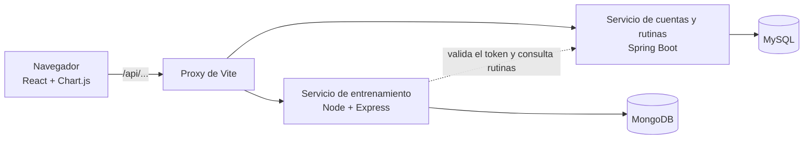
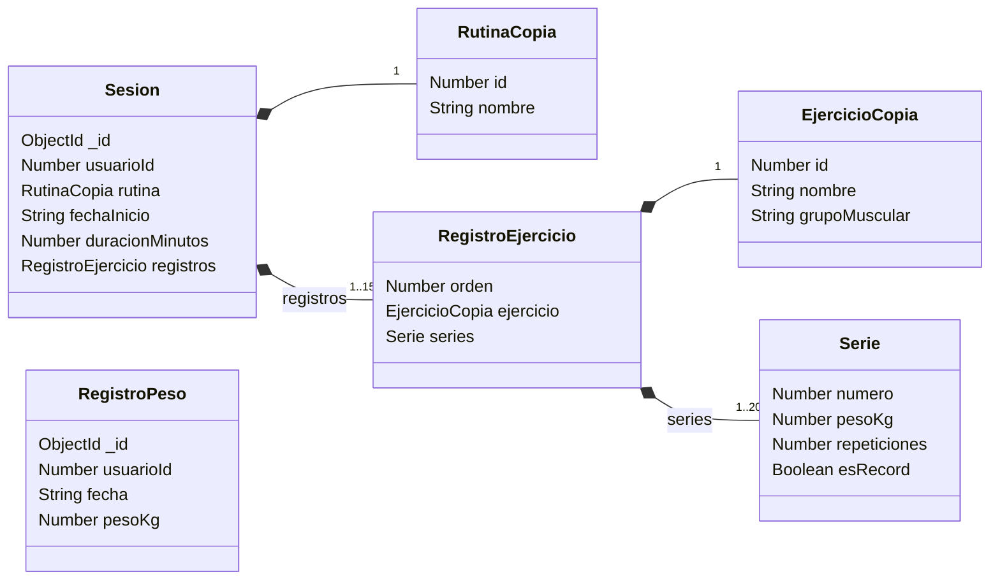
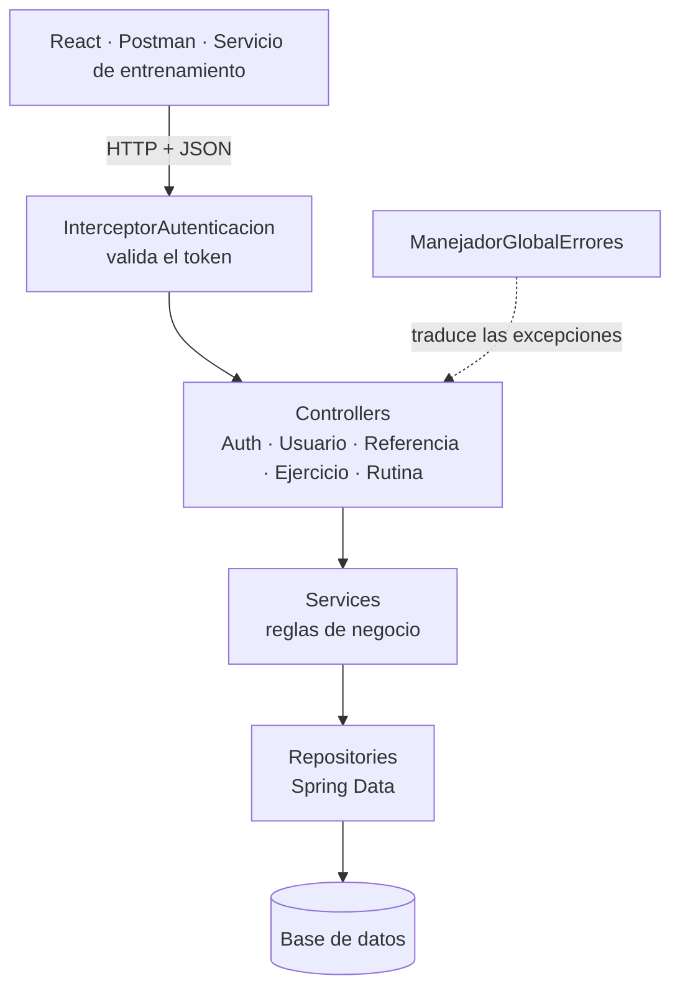
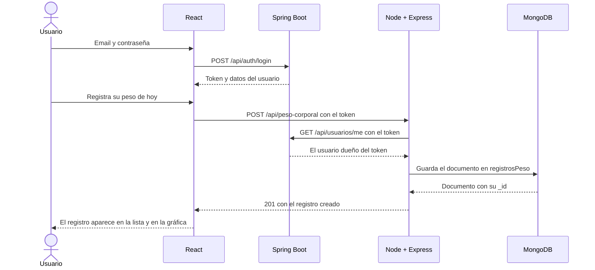

# Tarea: Spring Boot · NoSQL · React — GymRutine

**Entornos de Programación (24542)** · Universidad Industrial de Santander · Tarea *Sprint 1 - 2 Spring Boot - NoSQL - React*
**Repositorio:** https://github.com/rancesra/gymrutine · Volver al [README principal](../../README.md)

GymRutine es una aplicación web para personas que entrenan solas en el gimnasio: arman rutinas, registran cada serie y ven su progreso. Usa las tres tecnologías de la tarea: **Spring Boot** para el login, **MongoDB** como base de datos no relacional y **React** para la interfaz.

## Contenido

1. [Qué pide la tarea y dónde está](#1-qué-pide-la-tarea-y-dónde-está)
2. [Base de datos no relacional: MongoDB](#2-base-de-datos-no-relacional-mongodb)
3. [Backend con Spring Boot y login del usuario](#3-backend-con-spring-boot-y-login-del-usuario)
4. [CRUD de documentos](#4-crud-de-documentos)
5. [Frontend con React](#5-frontend-con-react)
6. [Cómo ejecutarlo](#6-cómo-ejecutarlo)

## 1. Qué pide la tarea y dónde está

| Lo que pide la tarea | Dónde está en GymRutine | Sección |
|---|---|---|
| Base de datos no relacional | **MongoDB 8.0**: base `gymrutine` con las colecciones `sesiones` y `registrosPeso` | [§2](#2-base-de-datos-no-relacional-mongodb) |
| Backend con Spring Boot y login del usuario | Servicio de cuentas (`backend-spring/`): registro, inicio y cierre de sesión con contraseñas cifradas con BCrypt | [§3](#3-backend-con-spring-boot-y-login-del-usuario) |
| CRUD de un documento | **Peso corporal** y **sesiones de entrenamiento**, documentos de MongoDB con crear, listar, editar y eliminar. Las rutinas también tienen su CRUD en Spring Boot | [§4](#4-crud-de-documentos) |
| Frontend con React: login y CRUD | Pantallas de iniciar sesión y crear cuenta, y las pantallas de peso corporal, sesiones y rutinas | [§5](#5-frontend-con-react) |
| Documento anexo con gráficas | Este documento, con diagramas de arquitectura, de documentos, de capas y de secuencia | — |

### Arquitectura



**Cómo se reparte el trabajo:** Spring Boot maneja las cuentas, el login y las rutinas. Los documentos de MongoDB los maneja el servicio de entrenamiento (Node.js + Express + Mongoose), que valida cada petición con el token que emite Spring Boot. Así, el login de Spring Boot también protege el CRUD sobre MongoDB. El detalle está en la [arquitectura](../ARQUITECTURA.md).

## 2. Base de datos no relacional: MongoDB

Base `gymrutine` en MongoDB 8.0, con dos colecciones. En MongoDB no hay tablas ni uniones: **lo que se lee junto se guarda junto**. Una sesión se guarda completa, con sus ejercicios y sus series dentro del mismo documento.



`*--` es composición: el registro de cada ejercicio y sus series viven **dentro** del documento de la sesión, no en otra colección.

| Colección | Qué guarda | Índices |
|---|---|---|
| `registrosPeso` | Un registro de peso corporal por usuario y fecha | Único `{ usuarioId, fecha }`: si se repite la fecha, la API responde 409 `PESO_YA_REGISTRADO` |
| `sesiones` | Una sesión de entrenamiento con sus ejercicios y sus series | `{ usuarioId, fechaInicio }` para el historial y `{ usuarioId, registros.ejercicio.id }` para récords y progreso |

Un documento de `registrosPeso`:

```json
{ "_id": { "$oid": "66f1c3b8e4b0a1b2c3d4e601" }, "usuarioId": 7, "fecha": "2026-09-14", "pesoKg": 77.9 }
```

El ejemplo completo de una sesión y las reglas de cada campo están en el [modelo de datos](../MODELO-DATOS.md#5-mongodb-modelo-de-documentos).

**Base en la nube:** la base corre en local con MongoDB Community Server. Para usar una base en la nube, como MongoDB Atlas, basta con cambiar `MONGODB_URI` en `backend-node/.env`. El código no cambia, porque la conexión se lee de esa variable (`backend-node/src/config/db.js`).

## 3. Backend con Spring Boot y login del usuario

El servicio de cuentas (`backend-spring/`, Spring Boot 4.1 con Java 21) maneja los usuarios, el login, el catálogo de ejercicios y las rutinas.

| Endpoint | Qué hace |
|---|---|
| `POST /api/auth/registro` | Crea la cuenta. La contraseña se guarda cifrada con BCrypt |
| `POST /api/auth/login` | Compara la contraseña con BCrypt y entrega un token que vence en 7 días, junto con los datos del usuario |
| `POST /api/auth/logout` | Borra el token: la sesión queda cerrada |
| `GET /api/usuarios/me` | Devuelve el usuario dueño del token. Lo usa también el servicio de entrenamiento para validar cada petición |

**Cómo se protege la API:** un interceptor (`InterceptorAutenticacion`) revisa la cabecera `Authorization: Bearer <token>` en todas las rutas `/api/**`, menos en el registro, el login y las referencias. Sin token válido responde 401. El usuario siempre sale del token, nunca de la URL ni del cuerpo.



- **Controller:** recibe la petición, valida la entrada y convierte entre HTTP y DTOs.
- **Service:** aplica las reglas de negocio. Las operaciones que escriben son transaccionales.
- **Repository:** interfaces de Spring Data que escriben las consultas a partir del nombre del método.
- **ManejadorGlobalErrores:** convierte las excepciones al formato `{codigo, mensaje, campos}`.

## 4. CRUD de documentos

### Documentos en MongoDB

| Operación | Peso corporal (`registrosPeso`) | Sesiones (`sesiones`) |
|---|---|---|
| Crear | `POST /api/peso-corporal` | `POST /api/sesiones` |
| Leer | `GET /api/peso-corporal` | `GET /api/sesiones` · `GET /api/sesiones/{id}` |
| Actualizar | `PUT /api/peso-corporal/{id}` | `PUT /api/sesiones/{id}` |
| Eliminar | `DELETE /api/peso-corporal/{id}` | `DELETE /api/sesiones/{id}` |

Cada consulta filtra por el `usuarioId` del token: el registro de otro usuario responde 404, igual que uno que no existe.

### Rutinas en Spring Boot

| Operación | Endpoint |
|---|---|
| Crear | `POST /api/rutinas` |
| Leer | `GET /api/rutinas` · `GET /api/rutinas/{id}` |
| Actualizar | `PUT /api/rutinas/{id}` |
| Eliminar | `DELETE /api/rutinas/{id}` (borrado lógico: sus sesiones siguen en el historial) |

### Del login al documento en MongoDB



Los 29 endpoints, con sus modelos y errores, están en el [contrato de API](../CONTRATO-API.md) y listos para probar en la [colección de Postman](../../postman/README.md).

## 5. Frontend con React

El frontend (`frontend/`, React 19 con Vite) solo habla con la API. El proxy de Vite manda `/api/sesiones`, `/api/records`, `/api/progreso` y `/api/peso-corporal` al servicio de entrenamiento, y el resto de `/api` al servicio de cuentas.

### Login del usuario

| Pieza | Qué hace |
|---|---|
| `PaginaLogin` (`/login`) y `PaginaRegistro` (`/registro`) | Iniciar sesión y crear cuenta |
| `AuthProvider` | Guarda el token y el usuario en `localStorage`, así la sesión sigue abierta al recargar |
| `api/cliente.js` | Envía el token en la cabecera `Authorization: Bearer` de cada petición. Si la API responde 401, cierra la sesión |
| `RutaPrivada` | Si no hay sesión iniciada, manda a `/login` |

### Pantallas de los CRUD

| CRUD | Pantalla | Qué se hace ahí |
|---|---|---|
| Peso corporal | `/progreso/peso` | Registrar el peso del día, ver la lista y la gráfica, corregir y eliminar un registro |
| Sesiones | `/rutinas/:id/entrenar`, `/historial` y `/historial/:id` | Registrar una sesión serie por serie, ver el historial, ver el detalle, editar y eliminar |
| Rutinas | `/rutinas`, `/rutinas/nueva` y `/rutinas/:id/editar` | Crear, listar, editar y eliminar rutinas |

## 6. Cómo ejecutarlo

| Pieza | Comando | Dirección |
|---|---|---|
| MySQL 8.4 y MongoDB 8.0 | Servicios del sistema operativo | `localhost:3306` y `localhost:27017` |
| Servicio de cuentas (Spring Boot) | `./mvnw spring-boot:run` en `backend-spring/` (Windows: `.\mvnw.cmd spring-boot:run`) | http://localhost:8080/api/referencias |
| Servicio de entrenamiento (Node) | `npm run dev` en `backend-node/` | http://localhost:3000/salud |
| Frontend (React) | `npm run dev` en `frontend/` | http://localhost:5173 |

La instalación y el primer arranque, paso a paso para Windows y macOS, están en la [guía de inicio](../../GUIA-INICIO.md).
